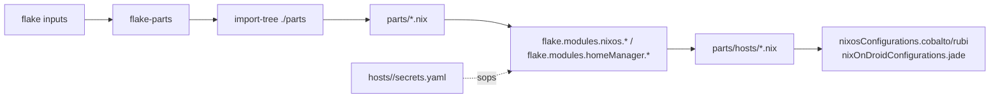
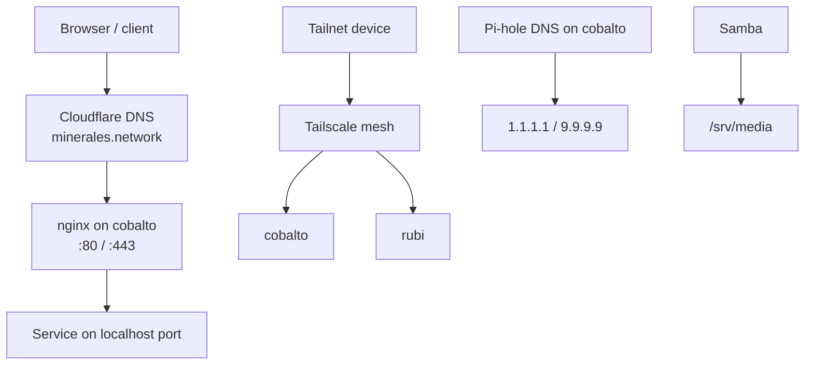
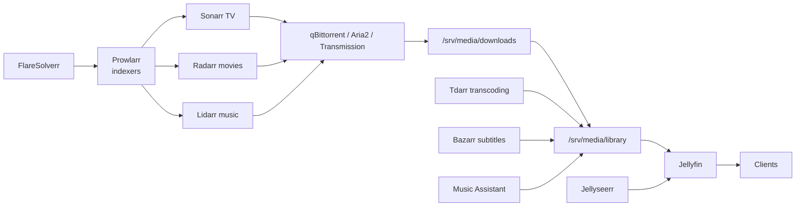
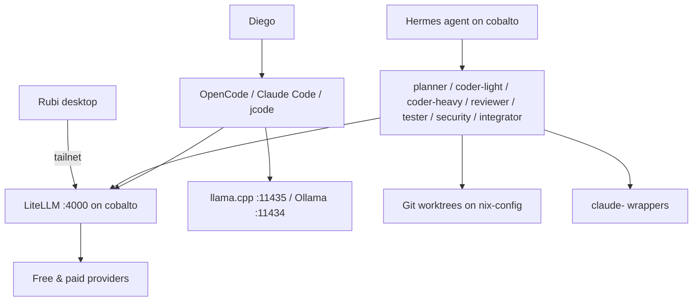
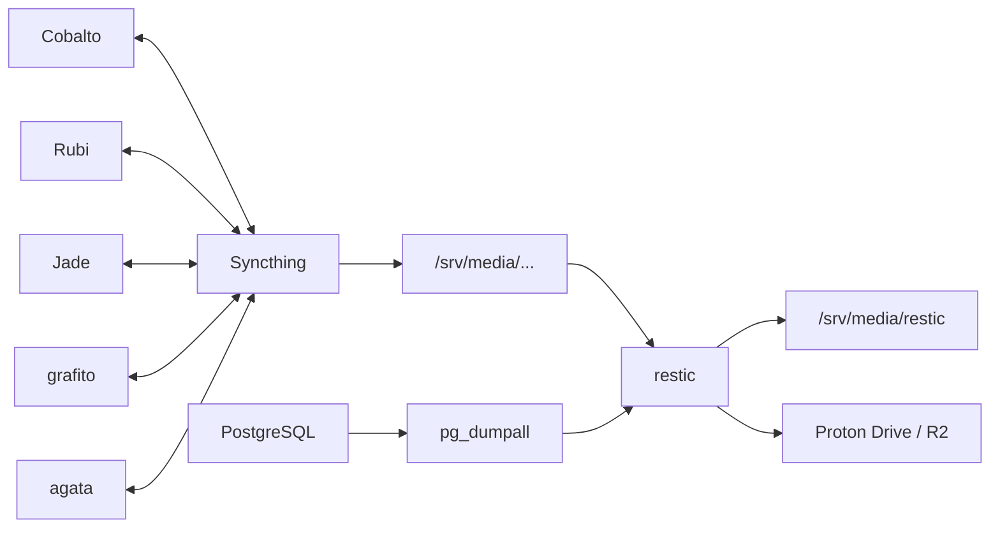
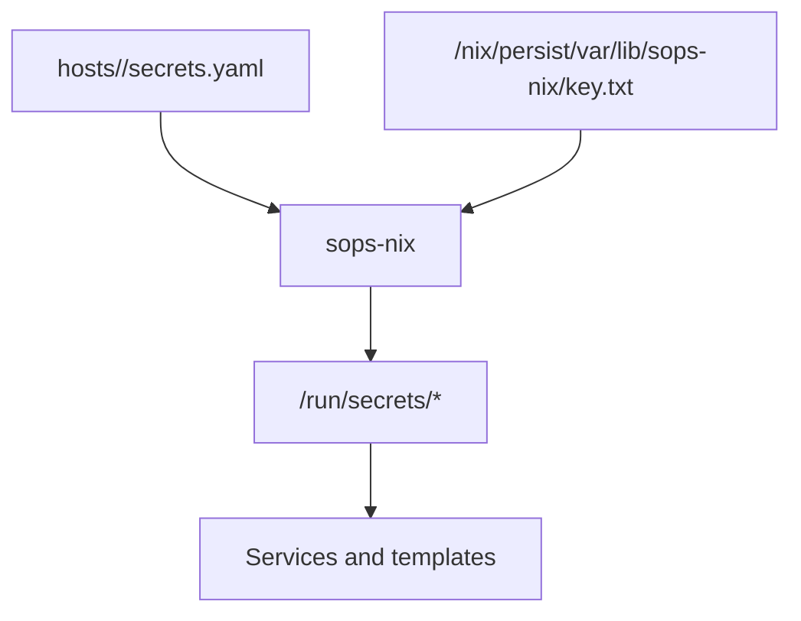

# nix-config

Public Nix flake that builds and configures Diego's machines: **cobalto** (home
server), **rubi** (desktop) and **jade** (nix-on-droid phone). It uses
[flake-parts](https://github.com/hercules-ci/flake-parts) with the *dendritic*
pattern: every `parts/*.nix` file is imported automatically and contributes to
`flake.modules.*`, which the host definitions in `parts/hosts/*.nix` compose.

Secrets and customer data live in the separate `nix-private-config` repo (input
`private-config`); this repo must stay public-safe and never name customers.

## Machines

| Machine | Role | Hardware / OS | Notable traits |
|---|---|---|---|
| **cobalto** | Headless media + AI + home-automation server | AMD CPU/GPU, SSD, NixOS (impermanence) | btrfs root wipe on boot, `/nix/storage` + `/srv/media`, Tailscale exit node, nginx + ACME |
| **rubi** | Desktop workstation | Intel CPU, AMD GPU, NixOS (impermanence) | Sway, PipeWire, Docker, Cloudflare WARP, Tailscale client |
| **jade** | Android phone (Termux) via nix-on-droid | aarch64-linux | SSH on 8022, optional on-device llama.cpp server, Syncthing device |

cobalto and rubi share a Tailscale tailnet (`minerales.network`); rubi can use
cobalto as an exit node and pulls the LiteLLM pool from it.

## Repository layout

```
flake.nix                 # inputs
parts/
  systems.nix             # supported systems
  hosts/{cobalto,jade,rubi}.nix   # flake outputs
  homes.nix               # home-manager wiring
  deploy.nix              # deploy-rs
  packages.nix / overlays.nix
  nixos/
    global/               # every NixOS host
    optional/<area>/      # opt-in modules (ai, apps, desktop, media, network, system)
    hosts/<host>/         # host config + impermanence
  home/
    features/{ai,audio,cli,desktop}/
    {cobalto,rubi}.nix    # per-host home selection
hosts/<host>/             # secrets.yaml, hardware-configuration, sshd_config
pkgs/                     # custom packages
docs/                     # runbooks + specs/plans
assets/                   # homepage icons, audio themes
```

## How the flake is wired



Each optional module is one file under `parts/nixos/optional/<area>/` and is
enabled by name in the host's `parts/nixos/hosts/<host>/default.nix`. Home
features follow the same pattern under `parts/home/features/`.

## Networking & access

- Public domain **minerales.network** with a Cloudflare DNS-01 wildcard cert
  (`*.minerales.network`), terminated by **nginx** on cobalto.
- **Tailscale** mesh between cobalto (exit node / router) and rubi (client);
  Pi-hole DNS on cobalto serves the tailnet and ad-blocks.
- **Samba** shares `/srv/media` and `/nix/storage` as `media`/`storage`.
- **Syncthing** replicates folders between cobalto, rubi, jade, grafito, agata.



## Service topology (cobalto)

All of the following are reverse-proxied by nginx under
`https://<name>.minerales.network` unless noted.

| Service | Port | Notes |
|---|---|---|
| Homepage | 8082 | Dashboard |
| Jellyfin | 8096 | Media server, HW accel |
| Jellyseerr | 5055 | Request portal |
| Tdarr | 8265 | Transcoding |
| qBittorrent | 8080 | (URL labelled "transmission") |
| Aria2 | 6800 | Download server |
| Prowlarr | 9696 | Indexer manager |
| FlareSolverr | 8191 | Cloudflare bypass for indexers |
| Sonarr | 8989 | TV |
| Radarr | 7878 | Movies |
| Lidarr | 8686 | Music |
| Bazarr | 6767 | Subtitles |
| Syncthing | 8384 | GUI |
| Cockpit | 9090 | System admin |
| Portainer | 8098 | Containers |
| llama.cpp | 11435 | Local LLM (OpenAI API) |
| JupyterLab | 8888 | Notebooks |
| Home Assistant | 8123 | Automation |
| Music Assistant | 8095 | Music streaming |
| Snapcast | 1780 | Multi-room audio |
| Vaultwarden | 8000 | Password vault |
| ZenNotes | 7879 | Notes server (vault `/srv/media/Obsidian/obsidiana`) |
| Hermes dashboard | 9119 | LAN/tailnet only |
| go2rtc | 1984/8554/8555/8557 | Camera streams |
| Miniflux | 8086 | RSS reader |
| BookOrbit | 8090 | Books |
| Pi-hole web | 8388 | DNS ad blocking |
| Litellm | 4000 | LLM gateway (tailnet only) |
| Ollama | 11434 | Local models |
| PostgreSQL | 5432 | Databases for services |
| matter-server | — | Home Assistant Matter |
| cameras (neolink) | 8554 | Reolink bridge |
| po-token-server | — | YouTube PoToken for Jellyfin |
| Home Assistant Matter | — | |

rubi runs the desktop stack (Sway, PipeWire, Bluetooth, printing, Docker) plus
Insync and ZenNotes desktop; it consumes cobalto's LiteLLM pool and mounts
cobalto media over Samba/Tailscale.

## Media pipeline



Media lives on `/srv/media` (separate physical disk on cobalto) and is shared
via Samba + Syncthing; servarr state is on `/nix/storage/servarr`.

## AI stack



Hermes dispatches coding agents into worktrees; only the `integrator` profile
pushes and opens PRs. Role prompts live in
`parts/nixos/optional/ai/hermes-roles/`.

## Sync & backups



Restic backs up `/srv/media/Obsidian/obsidiana` and `/srv/media/Repos` locally
and to Proton Drive / R2; Syncthing is replication only, not versioning.

## Secrets (sops-nix)



Per-host `.sops.yaml` rules; secrets are decrypted at activation. Templates
(e.g. `restic.env`, `hermes-nvidia.env`) are generated from placeholders.

## Storage & impermanence

cobalto and rubi use **impermanence**: root is wiped to a blank btrfs snapshot
on every boot, while `/nix/persist` (and `/nix/storage`, `/srv/media` on
cobalto) survive. Persisted paths include `/etc/ssh`, `/var/lib/*` for each
service, and `/home/diego`. Anything new that holds state must be added to the
host's `impermanence.nix`.

## Home manager

Per-host feature selection (`parts/home/{cobalto,rubi}.nix`) pulls from
`parts/home/features/{ai,audio,cli,desktop}`. Shared modules include stylix
theming, colors, monitors, bar, zellij, fish/nushell, git, SSH, XDG. AI tooling
(opencode, mcp, jcode, claude-code, cursor, agent-accounts, skills, system
prompt) comes from the `nix-ai-tooling` input.

## Deploy & operations

- cobalto: `deploy .#cobalto` (deploy-rs, builds on cobalto, connects as root
  over Tailscale). Rollback disabled.
- rubi/jade: built locally (`nixos-rebuild` / `nix-on-droid`).
- CI deploy lives in `nix-private-config` (workflow `deploy-cobalto`), triggered
  manually; a merge to `main` does not deploy.
- Checks: `nix flake check --no-build`; for host changes also build the toplevel.

## Conventions

See `CLAUDE.md`: dendritic module pattern, no `hosts/common/`, `git add` new
files before nix commands, persist state paths in impermanence, public-repo
hygiene, Hermes never edits this repo (coders work in worktrees, integrator
pushes/PRs).

## Further reading

- `docs/backups.md`, `docs/media-migration-runbook.md`
- `docs/agents/dev-rules.md`
- `docs/superpowers/{specs,plans}/`
